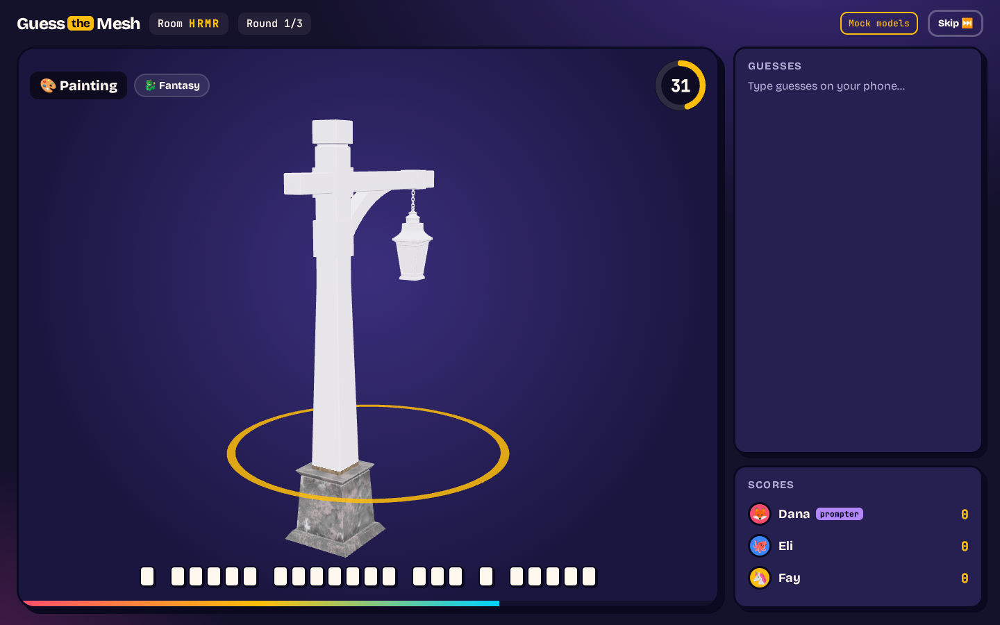
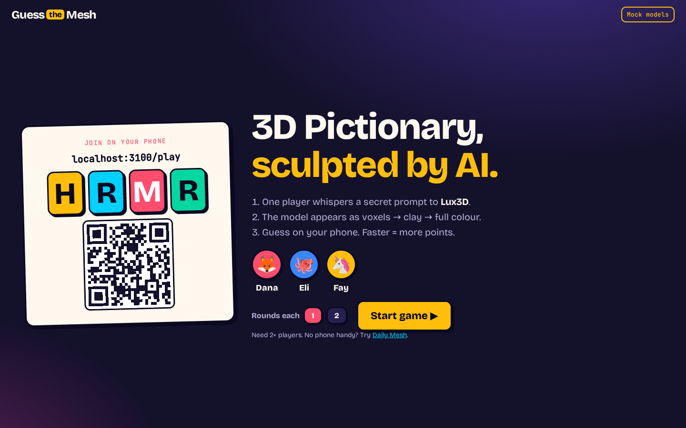
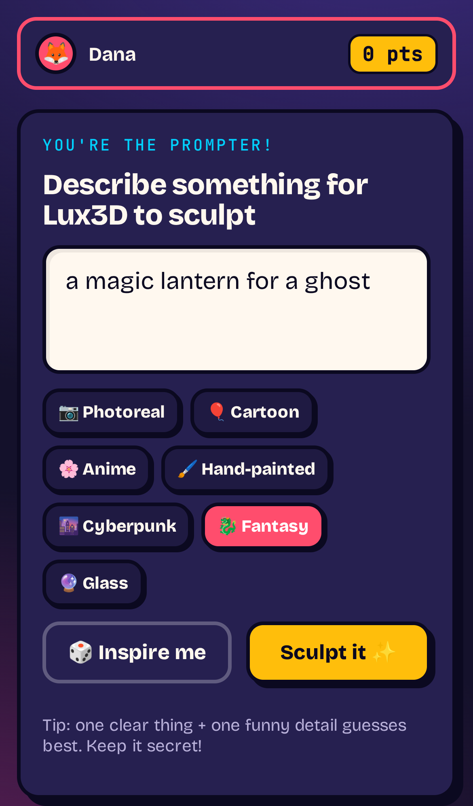
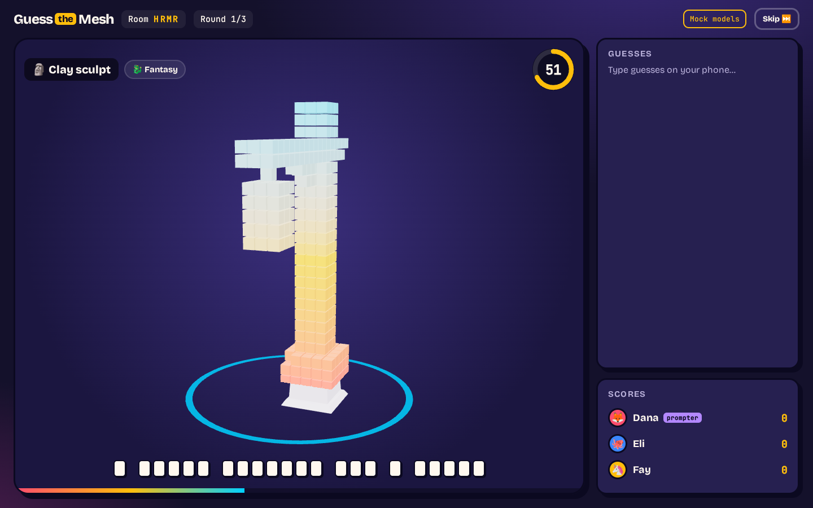
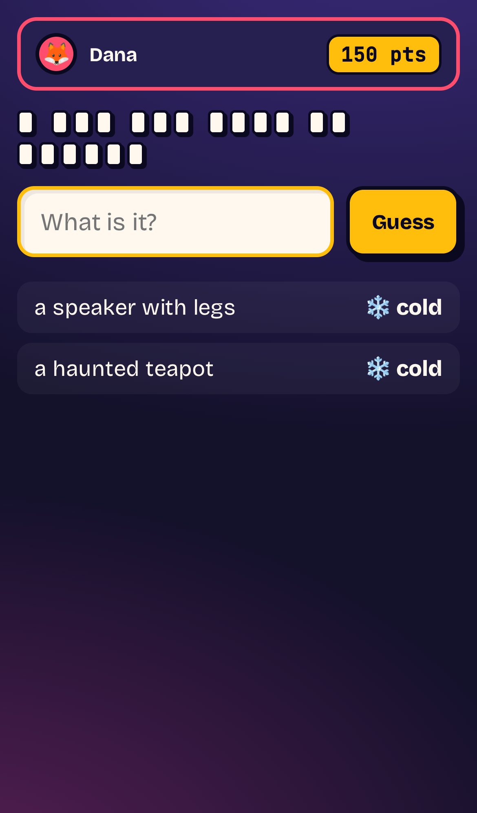

# 🧊 Guess the Mesh

**3D Pictionary where the AI does the sculpting.** Built for the Manycore **Aholo Global 3D AI Hackathon**.

One player secretly types a prompt on their phone ("a sleepy corgi wearing a crown"). **Lux3D text-to-3D** sculpts it into a real GLB model. On the big screen the model emerges in three acts — **chunky voxels → grey clay → full colour** — slowly rotating, while everyone else races to guess it from their phones. Faster correct guesses score more; the prompter scores when people get it.



| Lobby (TV/laptop) | Phone prompt | Clay stage | Phone guessing |
|---|---|---|---|
|  |  |  |  |

## Demo video

[`docs/demo/guess-the-mesh-demo.mp4`](docs/demo/guess-the-mesh-demo.mp4) (2:17, 1080p): real footage of a real game. The host screen and a real phone browser were recorded with Playwright while two socket bots (Eli, Fay) played along, and **both rounds were generated live by Lux3D** (G1-Turbo, cartoon style):

| Round | Prompt | Lux3D task | Generation |
|---|---|---|---|
| 1 | "a raccoon DJ with headphones" (typed on the phone) | 8259450 | 99 s |
| 2 | "a robot chef with a frying pan" (queued early by a bot) | 8259515 | 96 s |

Edits are labelled on screen: generation is sped up 10x, and the reveal is sped up 4x. The server ran with 4x game timings (`REVEAL_MS=200000 ROUND_MS=240000 ROUND_END_MS=24000`) because headless software GL renders only a few fps, so after the 4x speed-up the reveal plays at the game's normal pace (the on-screen countdown is in those stretched seconds). Solo / Daily Mesh uses the 12 pre-generated Lux3D models in `assets/daily`.

Narration: English voiceover (Mistral Voxtral TTS, voice "Paul – Cheerful"), script in [`docs/demo/voiceover-script.md`](docs/demo/voiceover-script.md); `scripts/make-voiceover.py` generates one clip per segment into `docs/demo/vo/` and muxes them onto the video without re-encoding it. The silent cut is kept as `docs/demo/guess-the-mesh-demo-silent.mp4`.

Rebuild: `scripts/record-demo.mjs` (capture, writes `docs/demo/raw/`), `scripts/demo-cards.mjs` (title, end and caption cards) and `scripts/make-demo.py` (ffmpeg edit). The host clip (`docs/demo/raw/host-game.webm`, 94 MB) is not in git.

## Modes

- **Party game** (`/host` on a TV or laptop, `/play` on phones): 4-letter room code + QR, 2–10 players, every player prompts once (or twice).
- **Daily Mesh / Endless** (`/solo`): pre-generated models, so it's fun alone and the demo never waits on generation. Shareable emoji score.
- **Gallery** (`/gallery`): every generated model with its prompt, who solved it, and all the wrong guesses (the funniest part). 3D viewer + **GLB download** per model.

## Lux3D usage

Lux3D is the engine of the game, not a side feature. Everything a player sees on the big screen came out of Lux3D.

| What | How we use it | Where |
|---|---|---|
| **Text-to-3D** (`textTo3d.create`) | Every round's model is generated live from the prompter's secret text, via `@manycore/aholo-sdk-lux3d` (`createLux3dClient({ region: 'com' })`). Defaults: `version: 'G1-Turbo'` (fastest), `outputFormat: ['glb']`, `faceCount: 50000` (light enough for phones/TVs), `enablePbr: true` (textured, so the final colour reveal pays off). | `server/src/lux3d.ts` |
| **Style parameter** | The prompter picks one of all 7 Lux3D styles (`photorealistic`, `cartoon`, `anime`, `hand_painted`, `cyberpunk`, `fantasy`, `glass`). The style is shown as a hint chip on screen, which adds strategy. | phone composer, `STYLES` in `server/src/shared.ts` |
| **Task polling** (`tasks.retrieve`) | We poll every 5s instead of a blind `waitFor`, so the host's "Sculpting…" screen shows real stages (queued → submitted → running → downloading). Status codes 0/1 = keep polling, 3 = success, 4/6 = failed/cancelled → the prompter is asked for a new prompt. | `realGenerate()` |
| **Result handling** | The GLB URL in `outputs[].content` expires after ~2h, so we download it to `data/models/<id>.glb` right away and serve it ourselves (gallery + downloads keep working). | `realGenerate()`, `store.ts` |
| **Concurrency** | Lux3D allows one in-flight generation per account (`GENERATION_CONCURRENCY_LIMIT_EXCEEDED`). A server-side **serial queue** feeds tasks one at a time, and `create` retries politely on that error. | `enqueue()` |
| **Pipelining to hide latency** | Generation takes 30–120s, so the **next prompter queues their prompt during the current round**. While players are guessing model N, Lux3D is already sculpting model N+1, and the next round usually starts instantly. | `submitPrompt()` in `rooms.ts` |
| **Pre-generation** | `npm run pregenerate` uses the same provider to batch-generate the Daily Mesh puzzle set into `assets/daily/` (12 curated prompts across styles). | `scripts/pregenerate.ts` |

Not used (on purpose): **image-to-four-view** as a "hint image" stage. It would cost a second generation per round, and with the one-task-per-account limit it would delay the 3D model. The voxel silhouette does the same job for free on the client.

## The reveal

`client/src/components/MeshReveal.tsx` takes any GLB and builds three versions of it:

1. **Voxels**: ~9k points sampled from the mesh surface (`MeshSurfaceSampler`), quantised into grids of 4³ → 27³ cells and drawn as one `InstancedMesh` with a pink → yellow → cyan height gradient. The resolution steps up with a little pop, so the silhouette sharpens over ~20s.
2. **Clay**: a clone with a matte grey `MeshStandardMaterial`, revealed bottom-up by a clipping plane, with a glowing scan ring. The voxels are clipped away above it.
3. **Colour**: the original PBR materials sweep up over the clay with a second clipping plane.

Progress is driven by the server clock (`revealStart` + `revealMs`), so the TV and every phone stay in sync. Correct guesses fire confetti and synth blips (WebAudio, no audio files).

## Scoring

`server/src/scoring.ts`: guesses are normalised (lowercase, stopwords, plurals), then each word is matched against the secret prompt with typo tolerance (Levenshtein), a synonym table (dog ≈ corgi ≈ puppy…) and substring credit. Score = 0.7 × recall + 0.3 × precision. ≥ 0.65 is **correct**, ≥ 0.30 is **close** (🔥 shown privately to the guesser). For a short prompt, naming the main noun is enough.

If `OPENROUTER_API_KEY` is set, guesses in the ambiguous band also go to an LLM judge (`OPENROUTER_MODEL`, default `openai/gpt-4o-mini`) with a 2.5s timeout. It falls back to local scoring if the judge fails or is slow.

Points: correct guess = 100–500 by speed. Prompter: +100 for the first solver, +50 for each one after.

## Run it

Requires Node 20+.

```bash
npm install
npm run build
LUX3D_MOCK=1 npm start          # http://localhost:3000  (mock models, no key needed)
AHOLO_API_KEY=... npm start     # real Lux3D (mock turns off automatically when a key is set)
```

Dev mode with hot reload: `npm run dev` (Vite on :5173, proxied to the server on :3000).

Open `/host` on the big screen and scan the QR code (or go to `/play`) on each phone.

### Environment

| Var | Default | |
|---|---|---|
| `AHOLO_API_KEY` | – | Lux3D key ([labs.aholo.ai/api-keys](https://labs.aholo.ai/api-keys)). Missing → mock mode |
| `LUX3D_MOCK` | – | `1` forces mock mode even with a key |
| `LUX3D_VERSION` | `G1-Turbo` | or `G1` (slower, higher quality) |
| `LUX3D_FACE_COUNT` | `50000` | 10000–300000 |
| `LUX3D_CONCURRENCY` | `1` | Lux3D allows 1 in-flight generation per account |
| `OPENROUTER_API_KEY` / `OPENROUTER_MODEL` | – / `openai/gpt-4o-mini` | optional LLM guess judge |
| `REVEAL_MS` / `ROUND_MS` / `ROUND_END_MS` / `PROMPT_TIMEOUT_MS` | 50000 / 60000 / 9000 / 90000 | game timing |
| `MOCK_DELAY_MS` | 9000 | simulated generation time in mock mode |
| `DATA_DIR` | `./data` | gallery.json + generated GLBs |
| `PORT` | 3000 | |

### Mock mode

With no key, the provider returns bundled glTF samples (Khronos glTF-Sample-Assets) after a simulated delay. It picks one by keyword when it can ("duck" → Duck, "car" → ToyCar…), so the whole loop (queue, sculpting screen, reveal, scoring, gallery, download) can be tested end to end.

### Deploy (Render)

`render.yaml` is a Blueprint for a Docker web service with `/api/health` health checks and a 1 GB disk at `/data` for the gallery. Set `AHOLO_API_KEY` in the dashboard. Any Docker host works the same way:

```bash
docker build -t guess-the-mesh . && docker run -p 3000:3000 -e AHOLO_API_KEY=... guess-the-mesh
```

## Tests and verification

```bash
# full game over Socket.io: 1 host + 3 bot players, checks pipelining, scoring, gallery, GLB download
LUX3D_MOCK=1 MOCK_DELAY_MS=4000 REVEAL_MS=12000 ROUND_MS=15000 ROUND_END_MS=3000 PORT=3100 npm start &
SIM_URL=http://localhost:3100 SIM_ROUNDS=3 npm run simulate

# headless screenshots (Playwright): host + phone + 2 bots play a real game
npx playwright install chromium
LUX3D_MOCK=1 MOCK_DELAY_MS=6000 REVEAL_MS=60000 ROUND_MS=75000 PORT=3100 npm start &
SHOT_URL=http://localhost:3100 npm run screenshots   # -> docs/screenshots/*.png
```

`?lowfx` on any page caps WebGL at ~5 fps and drops contact shadows. The screenshot script uses it because software GL is slow; it also helps underpowered TVs.

## Layout

```
server/src/
  index.ts      Express routes (+ /api/health, gallery, daily, GLB download, QR) + Socket.io
  rooms.ts      room state machine: lobby → prompting → generating → revealing → roundEnd → gameOver
  lux3d.ts      Lux3D provider (SDK), mock provider, serial generation queue
  scoring.ts    local fuzzy/synonym scoring;  judge.ts  optional OpenRouter LLM judge
  daily.ts      Solo / Daily Mesh puzzles (answers stay server-side)
  store.ts      gallery.json + models on disk
  shared.ts     types shared with the client
client/src/
  pages/        Home, Host (TV), Play (phone), Solo, Gallery
  components/   MeshReveal (voxel → clay → colour), Sculpting (waiting screen), WordHint
assets/samples  CC0/sample GLBs for mock mode;  assets/daily  Daily Mesh manifest (+ Lux3D GLBs once pre-generated)
scripts/        simulate.ts (e2e), screenshots.mjs (Playwright), pregenerate.ts (Lux3D batch)
```

## Credits

Mock and Daily Mesh seed models come from [KhronosGroup/glTF-Sample-Assets](https://github.com/KhronosGroup/glTF-Sample-Assets): Avocado, BoomBox, Lantern, WaterBottle, ToyCar and SheenChair are CC0. Fox is CC0 (model by PixelMannen) with CC-BY 4.0 rigging/animation by tomkranis and glTF conversion by @AsoboStudio and @scurest. Duck is under the SCEA Shared Source License. Replace them with Lux3D generations with `npm run pregenerate`.
